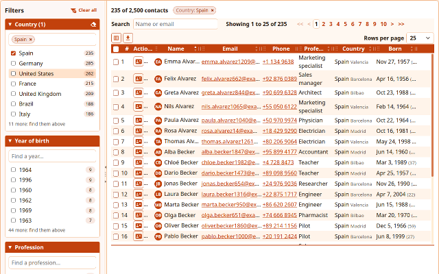
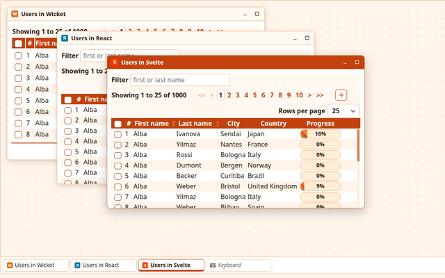

# Advanced Widgets

User interface components for [Apache Wicket](https://wicket.apache.org) 11, most of them also
for React and Svelte: data grids rendered from JSON, trees, drop-downs, date pickers, a code
editor, a rich text editor, split panels, tabs, menus, dialogs, a desktop of floating windows
and more. Every component takes the colors of a theme, speaks English, Spanish and German, and
uses no inline style or script, so it works under a strict Content Security Policy.

**Live demo: <https://antiliacode.com>**




## How it works

The browser side of each component is written once, in TypeScript, in
[`frontend/core`](frontend/README.md). From that core the build makes:

- the scripts and style sheets of the Wicket components, in `ui-components`, which the Java
  classes put on the page by themselves;
- `@antilia/react`, React 18 and 19 components wrapping the core;
- `@antilia/svelte`, Svelte 5 components, the core's functions also working as Svelte actions.

The Wicket components keep their state on the server as usual (the text and cursor of an editor,
the position of a divider, the open branches of a tree) and talk to the browser via Ajax or a
websocket. Many of them render their rows or cards in the browser from JSON and HTML templates,
so a grid of thousands of rows is one light component rather than thousands of Wicket ones.

## Components

| Category | Component | Wicket | React and Svelte |
|---|---|:-:|:-:|
| Data | JSON grid: sorting, paging, editing in a dialog, rows pushed over a websocket, movable and resizable columns, CSV export | ✓ | ✓ |
| | Bean grid: the same grid built from Wicket components | ✓ | |
| | Infinite list of cards rendered from JSON | ✓ | ✓ |
| | Filters above the grids and lists that ask the server once the typing pauses | ✓ | ✓ |
| | Tree and tree grid, from Wicket components or from JSON loaded on demand (WAI-ARIA) | ✓ | ✓ |
| Forms | Drop-down, one or many values as chips | ✓ | ✓ |
| | Autocomplete | ✓ | ✓ |
| | Palette: two lists to choose many values out of thousands | ✓ | ✓ |
| | Date and time pickers in the format and calendar of each locale | ✓ | ✓ |
| | Buttons, also turning any link or form button into one | ✓ | ✓ |
| | Downloads via Ajax, an iframe or a new tab, with a busy button | ✓ | |
| | Uploads in a form, by Ajax or to a resource, with a drop zone and a progress bar | ✓ | |
| | Code editor (CodeMirror): Java, JavaScript, TypeScript, JSON, Markdown with its preview | ✓ | ✓ |
| | Rich text editor (Tiptap), its HTML cleaned on the server, or Markdown | ✓ | ✓ |
| Feedback | Progress bar | ✓ | ✓ |
| | Notifications; Wicket's feedback messages become notifications by themselves | ✓ | ✓ |
| | Popovers | ✓ | ✓ |
| Layout | Scroll bars in the colors of the theme | ✓ | ✓ |
| | Split panel, nested, collapsible, its layout remembered by the server | ✓ | ✓ |
| | Resizable elements | ✓ | ✓ |
| | Tabs that close, asking first when they hold changes not saved | ✓ | ✓ |
| | Menus, horizontal or vertical, with submenus | ✓ | ✓ |
| | Modal dialog that keeps the focus, drags and folds | ✓ | ✓ |
| | Desktop of floating windows with a taskbar | ✓ | ✓ |
| Themes | Twelve themes, a theme editor, and a Bootstrap look beside the components' own | ✓ | ✓ |

The demo shows each of them, most in Wicket, React and Svelte side by side; the code of every
demo is in `demo-app` and `frontend/demo`.

## Themes and looks

A theme is a CSS class setting the `--antilia-theme-*` custom properties that the style sheets of
all components read. `ThemeBehavior` puts one on an element, the page's body for instance, and
every component inside it follows: `Theme.DEFAULT`, `BLUE`, `RED`, `DARK`, `BOOTSTRAP` and others,
or a class of your own made with the theme editor of the demo. A look gives the shapes and the
CSS classes of the parts: the components' own, or Bootstrap's (only its style sheet, never its
script). Themes and looks switch by class only, so a strict Content Security Policy is no
obstacle.

## Requirements

- Java 21 and Maven 3.9 or later.
- **Wicket 11.0.0-SNAPSHOT** in your local Maven repository: no repository serves it, so build it
  from [apache/wicket](https://github.com/apache/wicket) (see below).
- Nothing else: the build downloads Node and npm for the frontend into `frontend/node`.
- For the browser tests, Chrome and Firefox.

## Building

Build and install the Wicket modules the project uses, once and whenever Wicket's master moves
on:

```sh
git clone --depth 1 https://github.com/apache/wicket.git
mvn -f wicket/pom.xml install -DskipTests --also-make \
  --projects wicket-core,wicket-extensions,wicket-tester,wicket-native-websocket/wicket-native-websocket-core,wicket-native-websocket/wicket-native-websocket-javax,wicket-native-websocket/wicket-native-websocket-tester \
  -Dmaven.javadoc.skip=true -Dmaven.source.skip=true -Djacoco.skip=true -Djapicmp.skip=true -Drat.skip=true
```

Then build this project, with its tests:

```sh
mvn install
```

or without them, `mvn install -DskipTests`. The build compiles the frontend, runs its tests
(Vitest), minifies the scripts and style sheets, and builds the Java modules and their tests
(WicketTester, and Jetty for what needs a server).

Working on several branches at once, for example in git worktrees, give each its own version so
their snapshots don't overwrite each other in the local repository: put
`-Drevision=1.0.0-<branch>-SNAPSHOT` into the checkout's `.mvn/maven.config`.

## Running the demo

```sh
mvn install -DskipTests     # once, from the root
cd demo-app
mvn jetty:run -Dantilia-widgets.admin.password=<a password of your choice>
```

and open <http://localhost:8080> (or <https://localhost:8443>, with a test certificate). Locally:

- every session is signed in as `admin`, the account the password above creates; to sign in
  yourself instead, add `-Dantilia-widgets.sign-in-as=`;
- registering is open, and the confirmation emails go to the log;
- users and accesses are kept in an H2 database in a file under the system's temporary folder,
  or under `-Dantilia-widgets.data-folder=<folder>`. With `DATABASE_URL`, `DATABASE_USER` and
  `DATABASE_PASSWORD` the demo uses PostgreSQL instead, as in production;
  `deploy/postgres-local.yaml` starts one with Docker;
- the demo's own accounts, `admin`, `semedy` and `wicket`, get their passwords from the system
  properties `antilia-widgets.<account>.password` or the environment variables
  `ANTILIA_WIDGETS_<ACCOUNT>_PASSWORD`; the source holds none, and an account without one is not
  created.

`-Djetty.port=<port>` and `-Djetty.https.port=<port>` change the ports, and `-Dwicket.demo=true`
shows the branch and the commit in the footer.

## Using the components in a Wicket application

The components for Wicket 10 are published, built from the `line-10.x` branch on Wicket
10.11.0, without what needs Wicket 11 (uploads to a resource, Wicket's Ajax without jQuery):

- the snapshots, `10.11.0-SNAPSHOT`, on Maven Central's repository of snapshots;
- the release candidates, `10.11.0-RC1`, on GitHub Packages.

The releases will be on Maven Central, which needs no repository, only the dependency. The
Wicket 11 line, `master`, is not published yet: install it with `mvn install` and depend on
`1.0.0-SNAPSHOT`.

### The snapshots, from Maven Central

Maven Central serves the snapshots from a repository of their own, which needs no token. In
`build.gradle.kts`:

```kotlin
repositories {
    mavenCentral()
    maven {
        url = uri("https://central.sonatype.com/repository/maven-snapshots/")
        mavenContent {
            snapshotsOnly()
            includeGroup("com.antiliacode.widgets")
        }
    }
}

dependencies {
    implementation("com.antiliacode.widgets:ui-components:10.11.0-SNAPSHOT")
}
```

or in the `pom.xml`:

```xml
<repositories>
	<repository>
		<id>central-snapshots</id>
		<url>https://central.sonatype.com/repository/maven-snapshots/</url>
		<releases>
			<enabled>false</enabled>
		</releases>
		<snapshots>
			<enabled>true</enabled>
		</snapshots>
	</repository>
</repositories>

<dependencies>
	<dependency>
		<groupId>com.antiliacode.widgets</groupId>
		<artifactId>ui-components</artifactId>
		<version>10.11.0-SNAPSHOT</version>
	</dependency>
</dependencies>
```

### The release candidates, from GitHub Packages

GitHub Packages asks for a token even to read public packages: a GitHub personal access token
(classic) with the scope `read:packages`.

#### Gradle

Put your GitHub user and the token into `~/.gradle/gradle.properties`, out of the project:

```properties
gpr.user=<your GitHub user>
gpr.key=<the token>
```

Then, in `build.gradle.kts`:

```kotlin
repositories {
    mavenCentral()
    maven {
        url = uri("https://maven.pkg.github.com/reiern70/advanced-widgets")
        credentials {
            username = providers.gradleProperty("gpr.user").orNull ?: System.getenv("GITHUB_ACTOR")
            password = providers.gradleProperty("gpr.key").orNull ?: System.getenv("GITHUB_TOKEN")
        }
        // ask GitHub only for the components, the rest comes from Maven Central
        content {
            includeGroup("com.antiliacode.widgets")
        }
    }
}

dependencies {
    implementation("com.antiliacode.widgets:ui-components:10.11.0-RC1")
}
```

or in `build.gradle`:

```groovy
repositories {
    mavenCentral()
    maven {
        url = uri('https://maven.pkg.github.com/reiern70/advanced-widgets')
        credentials {
            username = findProperty('gpr.user') ?: System.getenv('GITHUB_ACTOR')
            password = findProperty('gpr.key') ?: System.getenv('GITHUB_TOKEN')
        }
        content {
            includeGroup 'com.antiliacode.widgets'
        }
    }
}

dependencies {
    implementation 'com.antiliacode.widgets:ui-components:10.11.0-RC1'
}
```

#### Maven

Put the token into `~/.m2/settings.xml`:

```xml
<settings>
	<servers>
		<server>
			<id>antilia-widgets</id>
			<username>your GitHub user</username>
			<password>the token</password>
		</server>
	</servers>
</settings>
```

and the repository, under the same id, and the dependency into the `pom.xml`:

```xml
<repositories>
	<repository>
		<id>antilia-widgets</id>
		<url>https://maven.pkg.github.com/reiern70/advanced-widgets</url>
	</repository>
</repositories>

<dependencies>
	<dependency>
		<groupId>com.antiliacode.widgets</groupId>
		<artifactId>ui-components</artifactId>
		<version>10.11.0-RC1</version>
	</dependency>
</dependencies>
```

### A page

Give the page a theme and use the components as any other Wicket component:

```java
public class EditPage extends WebPage
{
	private String country;

	public EditPage()
	{
		// the colors of every component in the page
		add(new TransparentWebMarkupContainer("body")
			.add(new ThemeBehavior(Theme.BLUE)));

		Form<Void> form = new Form<>("form");
		add(form);
		// a DropDownChoice drawn as the drop-down of the theme, filtered by keyboard
		form.add(new Dropdown<>("country", new PropertyModel<>(this, "country"),
			List.of("Argentina", "Germany", "Spain")));
	}
}
```

```html
<!DOCTYPE html>
<html xmlns:wicket="http://wicket.apache.org">
<head><title>Edit</title></head>
<body wicket:id="body">
	<form wicket:id="form">
		<select wicket:id="country"></select>
	</form>
</body>
</html>
```

Each component brings its scripts and style sheets; the classes, under `com.antiliacode.widgets`,
describe their options in their Javadoc.

The library holds every script twice: as the build wrote it, readable, and minified beside it
(`.min.js`, and `.min.css` for the style sheets). Wicket serves the readable ones in development
mode, so that what fails can be read and debugged in the browser, and the minified ones in
deployment mode. `getResourceSettings().setUseMinifiedResources(false)` in the application's
`init()` serves the readable ones in deployment mode too.

## Using the components in React and Svelte

The packages are in `frontend` (`@antilia/core`, `@antilia/react`, `@antilia/svelte`) and not
published to npm yet. [`frontend/README.md`](frontend/README.md) describes every component, its
options and how the three frameworks share the core.

```tsx
import { Dropdown } from '@antilia/react';

<Dropdown name="country" value={country} onChange={setCountry}
	options={[{ value: 'ar', label: 'Argentina' }, { value: 'es', label: 'Spain' }]} />
```

## Tests

`mvn verify` runs the Java and the frontend tests. The browser tests drive the demo in Chrome and
Firefox with Selenium:

```sh
mvn verify -Pselenium -pl demo-app
```

If Firefox is a launcher script rather than the browser itself, as with the Ubuntu snap, give
the binary: `-Dwicket.selenium.firefox=/snap/firefox/current/usr/lib/firefox/firefox`. The
browser suite takes about twenty minutes.

GitHub Actions builds and tests every pull request and push to `master`, against Wicket's
`master`, which it builds first.

## Project layout

| Folder | What it holds |
|---|---|
| `ui-components` | The Wicket components (`com.antiliacode.widgets.*`), with the scripts and style sheets built from `frontend/core` |
| `demo-app` | The demo application, a WAR: the pages of every component, sign-in and registration, the database |
| `frontend` | The TypeScript core, the React and Svelte packages and the React and Svelte pages of the demo |
| `deploy` | How the demo site runs: Docker, Caddy and PostgreSQL on Amazon Lightsail, see [`deploy/README.md`](deploy/README.md) |

## Problems and ideas

[GitHub issues](https://github.com/reiern70/advanced-widgets/issues).

## License

[Apache License 2.0](LICENSE), see also [NOTICE](NOTICE).
